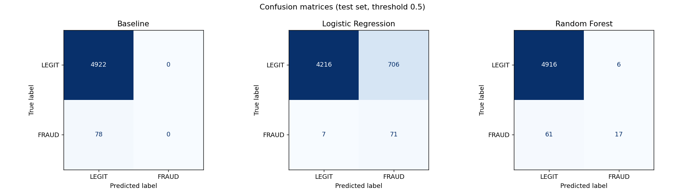
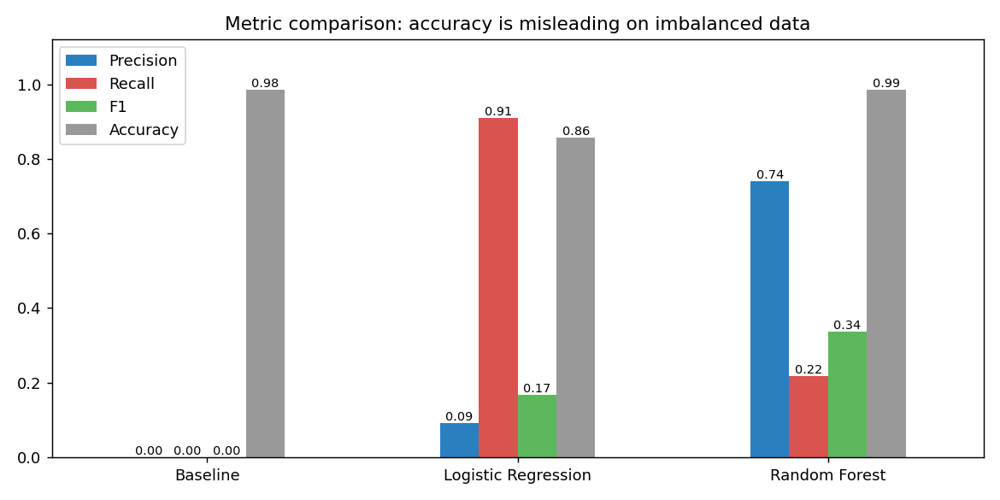
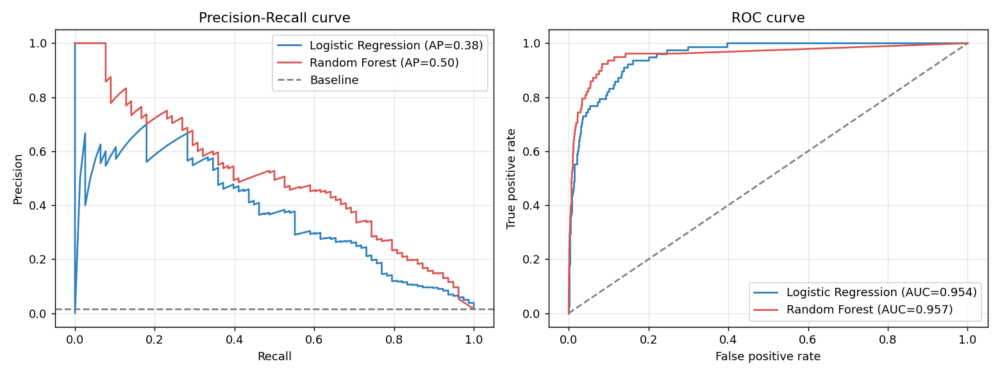
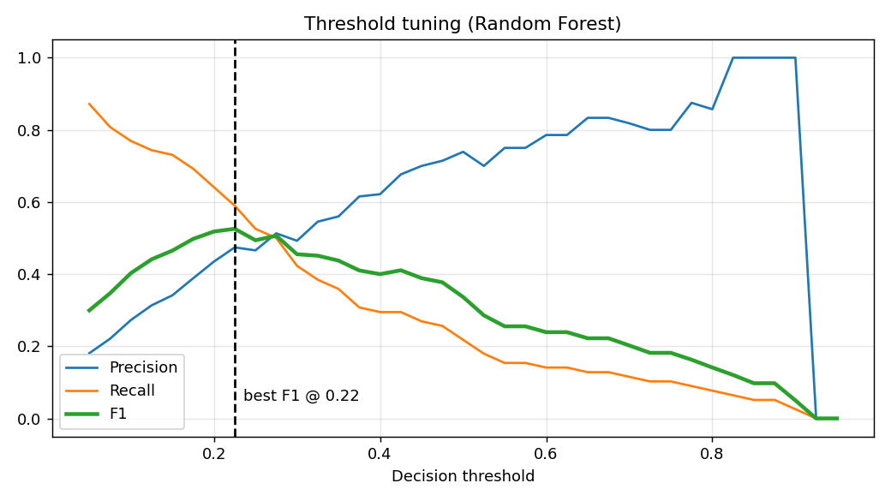
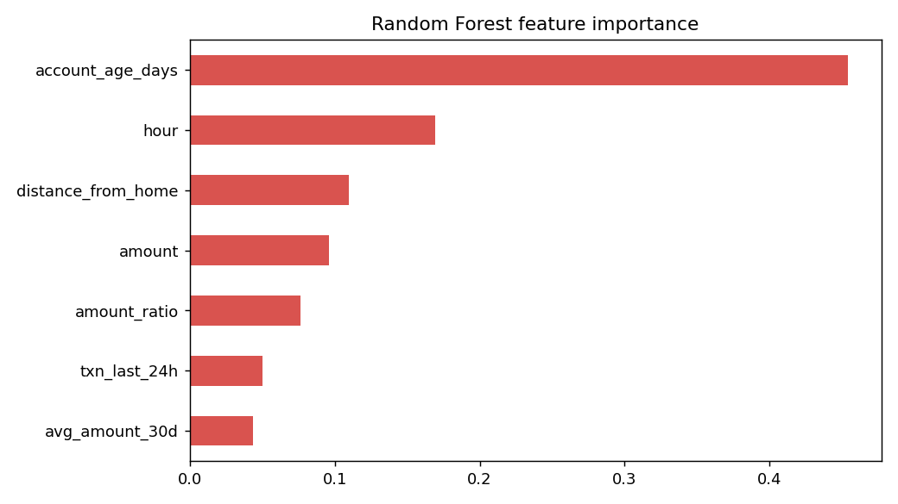
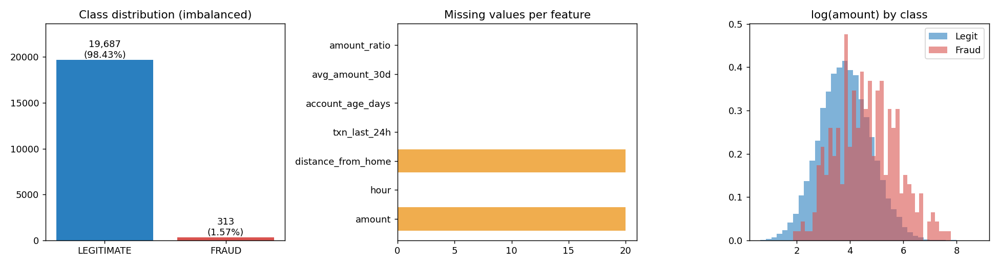
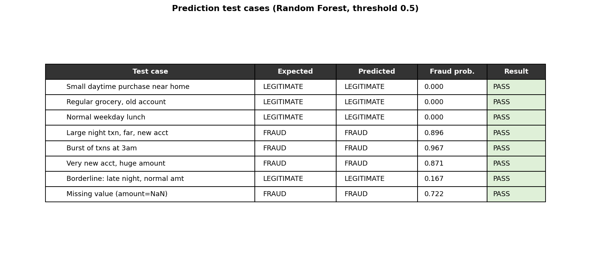
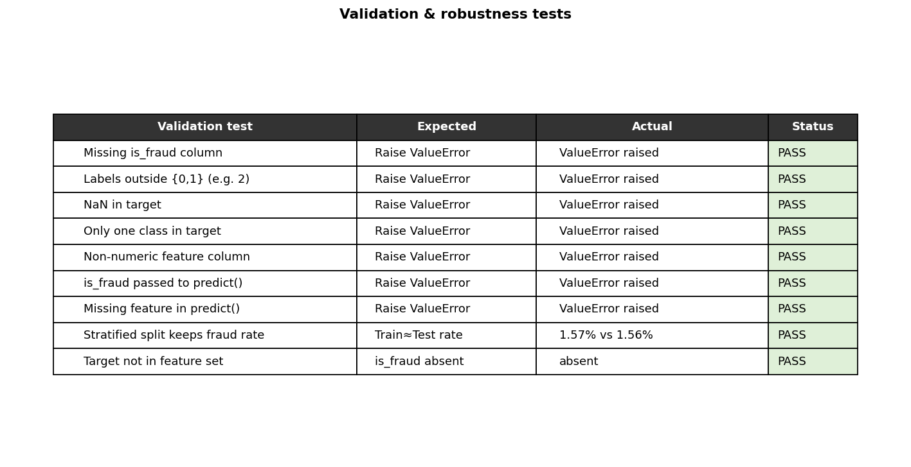

# Transaction Fraud Detection

Machine learning system that classifies financial transactions as **FRAUD** or **LEGITIMATE** on
highly imbalanced data (~1.6% fraud). Built with Python, Pandas, NumPy and scikit-learn.

Because fraud is rare, a model that always says "legitimate" is ~98% accurate yet useless.
This project therefore reports **precision, recall, F1, PR-AUC and a confusion matrix**, and
compares against that baseline.

---

## 1. Project structure

```
fraud_detection/
├── fraud_detection.py          # Main system: load, validate, split, train, evaluate, predict (CLI)
├── generate_data.py            # Creates a synthetic dataset -> transactions.csv
├── app.py                      # Python web application (Flask) with UI + JSON API
├── templates/index.html        # Web page template for app.py
├── test_app.py                 # Tests for the web app
├── run_report.py               # Runs everything and saves charts + test-case tables to results/
├── test_fraud_detection.py     # 15 automated tests (standard library unittest)
├── requirements.txt
├── transactions.csv            # Sample dataset (20,000 rows)
├── model.joblib                # Trained model (created by `train`)
├── results/                    # Images (PNG) + test-case CSVs
└── sample_output/              # Captured console output of every command below
```

## 2. Setup

Requires Python 3.9+.

```bash
pip install -r requirements.txt
```

## 3. Execution instructions

Run these from inside the `fraud_detection` folder, in order.

| Step | Command | What it does |
|------|---------|--------------|
| 1 | `python generate_data.py` | Creates `transactions.csv` (skip if you have your own CSV) |
| 2 | `python fraud_detection.py train --data transactions.csv --model model.joblib` | Validates data, splits, trains 3 models, prints metrics, saves best model |
| 3 | `python fraud_detection.py predict --model model.joblib --json '{...}'` | Predicts class + fraud probability for one transaction |
| 4 | `python -m unittest -v test_fraud_detection` | Runs the 15 automated tests |
| 5 | `python run_report.py` | Generates all result images in `results/` |

**Predict example**

```bash
python fraud_detection.py predict --model model.joblib --json '{"amount": 1200, "hour": 2, "distance_from_home": 300, "txn_last_24h": 7, "account_age_days": 40, "avg_amount_30d": 45, "amount_ratio": 26.7}'
```
Optional: `--threshold 0.3` flags more transactions as fraud (higher recall, lower precision).

**Using your own data:** a CSV with numeric feature columns and a binary `is_fraud` column (0/1).
Train with `--data your.csv`. For `predict`, supply exactly the feature names in your CSV.
(`run_report.py` and the unit tests use the sample feature names; edit the test-case dictionaries
if your columns differ.)

## 3b. Web application (Python / Flask)

```bash
python app.py            # then open http://127.0.0.1:5000
```

1. **Load data**: click *Use sample data* or upload a CSV (numeric features + 0/1 `is_fraud`). Validation results are shown on the page.
2. **Train models**: trains baseline, Logistic Regression and Random Forest; shows precision, recall, F1, PR-AUC, accuracy, a confusion matrix, a threshold slider and charts.
3. **Check a transaction**: fill the form (or use the typical legitimate/fraud profile) and get FRAUD or LEGITIMATE plus a fraud probability.
4. **Test cases**: the page lists 8 sample transactions with expected results. *Run all test cases* shows predicted class, probability and PASS/FAIL for each, plus 9 validation checks (bad inputs must be rejected). *Load* puts any case into the form in step 3.
5. **Test cases from the trained data**: real rows from the held-out test split (never seen in training) with their true labels, grouped as caught fraud, missed fraud, false alarm and correct legitimate. They update with the model and threshold you choose, and each row can be loaded into the form. Works with your own CSV too.

JSON API (after training in the UI):
```bash
curl -X POST http://127.0.0.1:5000/api/predict -H "Content-Type: application/json" \
  -d '{"transaction": {"amount":1200,"hour":2,"distance_from_home":300,"txn_last_24h":7,"account_age_days":40,"avg_amount_30d":45,"amount_ratio":26.7}, "model":"rf", "threshold":0.5}'
# {"fraud_probability":0.896,"model":"rf","prediction":"FRAUD"}
```
Run the web-app tests with `python -m unittest -v test_app`. Training state is held in memory for one user, which is fine for a demo but not a multi-user deployment.

## 4. How it meets the requirements

| # | Requirement | Implementation |
|---|-------------|----------------|
| 1 | Load CSV with `is_fraud` target | `load_data()` |
| 2 | Validate missing values, dtypes, labels | `validate_data()` – rejects missing target column, non-0/1 labels, NaN labels, single-class target, non-numeric features; reports missing values and duplicates |
| 3 | Stratified train/test split | `split_data()` – 75/25, `stratify=y` |
| 4 | Train a model | `build_model()` – Logistic Regression and Random Forest (`class_weight` for imbalance) |
| 5 | Precision, recall, F1, confusion matrix | `evaluate()` |
| 6 | Compare to baseline | `DummyClassifier(strategy="most_frequent")` |
| 7 | Predict class + probability | `predict_transaction()` and `predict` CLI |
| – | Target never used as a feature | Dropped in `split_data()`; rejected by `predict_transaction()` |

Design notes: imputation and scaling live inside a scikit-learn `Pipeline` and are fitted on training
data only (no leakage). The best model is chosen by PR-AUC rather than accuracy.

---

## 5. Sample output

### 5.1 Training (`sample_output/train_output.txt`)

```
Loaded 20000 rows x 8 columns from transactions.csv

--- Validation report ---
Missing values per column: {'amount': 20, 'distance_from_home': 20}
Duplicate rows: 0
Class distribution:
LEGITIMATE (0)    19687
FRAUD (1)           313
Fraud rate: 1.57%

Train: 15000 rows (fraud 1.57%) | Test: 5000 rows (fraud 1.56%)

=== Model comparison ===
                           precision  recall      f1  pr_auc  roc_auc  accuracy
Baseline (majority class)     0.0000  0.0000  0.0000  0.0156   0.5000    0.9844
Logistic Regression           0.0914  0.9103  0.1661  0.3775   0.9539    0.8574
Random Forest                 0.7391  0.2179  0.3366  0.5024   0.9567    0.9866

Best model by PR-AUC: Random Forest
Saved model to model.joblib
```

### 5.2 Prediction (`sample_output/predict_output.txt`)

```
{ "prediction": "LEGITIMATE", "fraud_probability": 0.0 }      # normal daytime purchase
{ "prediction": "FRAUD",       "fraud_probability": 0.896 }    # large 2am txn, far away, new account
Error: 'is_fraud' must not be supplied as an input feature.    # target column rejected
```

---

## 6. Results

### 6.1 Model performance (test set: 5,000 transactions, 78 fraud)

| Model | Precision | Recall | F1 | PR-AUC | Accuracy |
|---|---|---|---|---|---|
| Baseline (always LEGITIMATE) | 0.00 | 0.00 | 0.00 | 0.016 | 98.4% |
| Logistic Regression | 0.09 | 0.91 | 0.17 | 0.378 | 85.7% |
| Random Forest | 0.74 | 0.22 | 0.34 | 0.502 | 98.7% |

Confusion matrices (threshold 0.5):

| Model | TN | FP | FN | TP |
|---|---|---|---|---|
| Baseline | 4922 | 0 | 78 | 0 |
| Logistic Regression | 4216 | 706 | 7 | 71 |
| Random Forest | 4916 | 6 | 61 | 17 |

**Interpretation.** The baseline reaches 98.4% accuracy while catching zero fraud, so accuracy alone is
misleading. Logistic Regression catches 71 of 78 frauds but raises 706 false alarms. Random Forest is
precise (6 false alarms) but misses most fraud at the default threshold. Lowering the threshold
(see chart 05) moves Random Forest toward a better precision/recall balance. Data is synthetic, so
these numbers demonstrate the pipeline, not real-world fraud performance.








### 6.2 Prediction test cases (Random Forest, threshold 0.5) — 8/8 passed

| Test case | Expected | Predicted | Fraud prob. | Result |
|---|---|---|---|---|
| Small daytime purchase near home | LEGITIMATE | LEGITIMATE | 0.000 | PASS |
| Regular grocery, old account | LEGITIMATE | LEGITIMATE | 0.000 | PASS |
| Normal weekday lunch | LEGITIMATE | LEGITIMATE | 0.000 | PASS |
| Large night txn, far, new account | FRAUD | FRAUD | 0.896 | PASS |
| Burst of transactions at 3am | FRAUD | FRAUD | 0.967 | PASS |
| Very new account, huge amount | FRAUD | FRAUD | 0.871 | PASS |
| Borderline: late night, normal amount | LEGITIMATE | LEGITIMATE | 0.167 | PASS |
| Missing value (amount = NaN) | FRAUD | FRAUD | 0.722 | PASS |



### 6.3 Validation and robustness tests — 9/9 passed



### 6.4 Automated unit tests — 15/15 passed (`sample_output/unittest_results.txt`)

```
Ran 15 tests in 1.108s
OK
```

## 7. Limitations and next steps
- Synthetic data; real fraud data is noisier and has concept drift.
- Default 0.5 threshold is not optimal; choose the threshold from business cost of missed fraud vs false alarms.
- Possible extensions: gradient boosting, SMOTE/undersampling, cost-sensitive evaluation, REST API (FastAPI).
